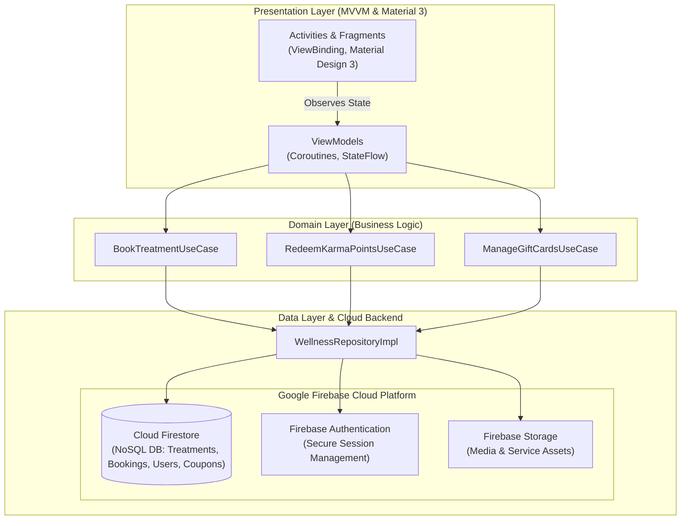

# Hammami Hub: Wellness Center Booking & Customer Loyalty Android App

[](https://kotlinlang.org/)
[]()
[](https://firebase.google.com/)
[]()
[]()
[](LICENSE)

> A production-ready native Android application engineered to digitize the entire booking and customer loyalty lifecycle for wellness centers, built on **Clean Architecture**, **MVVM**, and **Google Firebase**.

---

## 📖 Overview & Business Value

Traditional wellness and spa facilities often rely on manual, friction-heavy booking processes (phone calls, paper calendars) and lack automated customer retention tools.

**Hammami Hub** bridges this gap through a frictionless, *"walk-up-and-use"* mobile experience:
- **Instant Slot Booking:** Real-time visibility into treatments, staff availability, and immediate checkout.
- **Automated Retention Engine:** Customers earn **Karma Points** proportional to spending, which convert into redeemable coupons and digital gift cards directly at checkout.
- **Administrative Relief:** Real-time synchronization eliminates double-booking errors and reduces phone inquiries.

---

## 🏛️ System Architecture

The application is structured into distinct, modular layers following **Clean Architecture** to ensure testability and high cohesion:



---

## ✨ Core Features

1. **Live Services Catalog:** Filter treatments by category (Aesthetics, Massages, Holistic Care), with duration, pricing, and practitioner details.
2. **Dynamic Karma Points Loyalty System:** Automated point accrual per booking, redeemable for discount vouchers.
3. **In-App Digital Gift Cards:** Purchase, customize, and transfer electronic gift cards natively.
4. **Secure User Profile & History:** Access upcoming appointments, past treatment notes, and invoices.
5. **Verified Customer Feedback:** Transparent review engine after completed appointments.

---

## 📱 UI & Screen Showcase

| Home Dashboard | Services Catalog | Service Details |
| :---: | :---: | :---: |
|  |  |  |

### Navigation Architecture Map
<p align="center">
  
</p>

---

## 🛠️ Tech Stack

- **Language:** Kotlin
- **Architecture:** Clean Architecture (Data, Domain, Presentation) + MVVM
- **Dependency Injection:** Dagger Hilt
- **Backend as a Service:** Google Firebase (Cloud Firestore, Authentication, Cloud Storage)
- **Asynchrony:** Kotlin Coroutines
- **UI Framework:** Android ViewBinding, XML Layouts, Material Design 3
- **Error Handling:** Custom Result/Either sealed classes wrapping Firebase network exceptions

---

## 🚀 Setup & Local Execution

1. Clone the repository:
   ```bash
   git clone https://github.com/hidemet/hammami-wellness-app.git
   cd hammami-wellness-app
   ```
2. Open the project in **Android Studio**.
3. Place your `google-services.json` file inside the `app/` directory (or use the provided sandbox config).
4. Build and run on an Android emulator or device (Min SDK 26, Target SDK 34).

---

## 📄 License

Released under the [MIT License](LICENSE).
